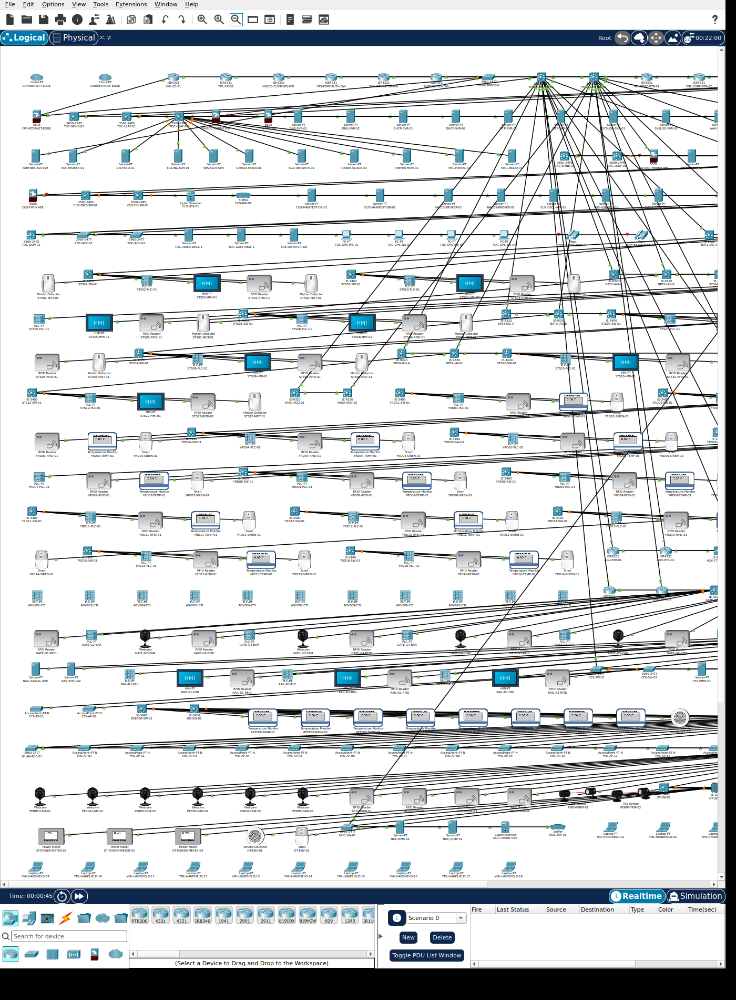
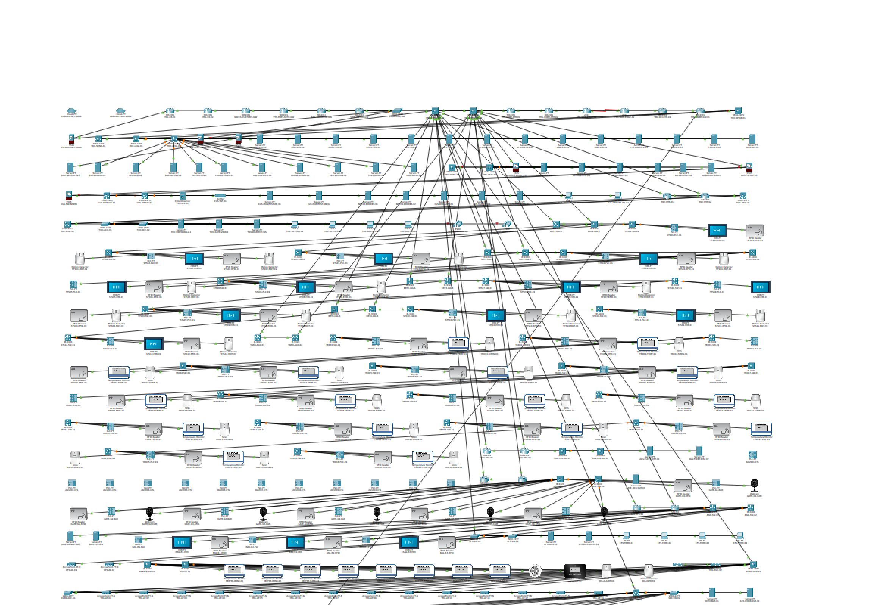
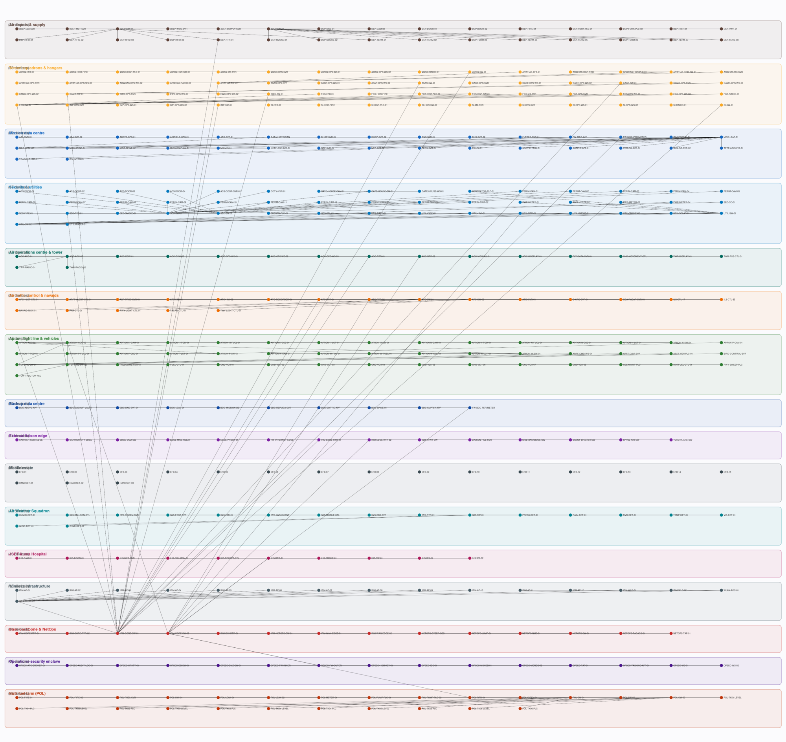
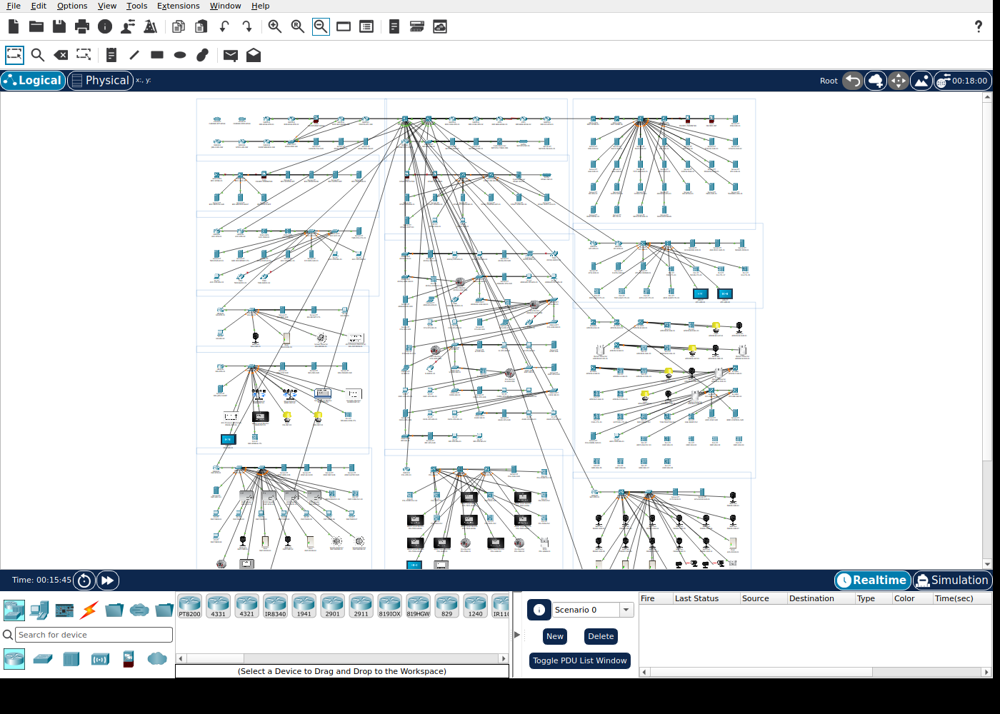
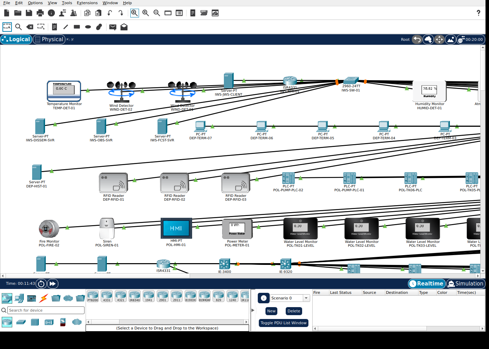

# Large-Scale Packet Tracer

Enterprise-scale Cisco Packet Tracer models, generated entirely from code and
verified to open and render in **Packet Tracer 9.0.1**.

Two networks. **778 devices, 752 links, 28,073 configuration lines** across the
full-size builds, with smaller profiles of each for iteration.

---

## Contents

| # | Network | Full build | Devices | Links | Config lines | Tiers | Size |
| --- | --- | --- | ---: | ---: | ---: | ---: | ---: |
| [1](#chapter-1--yokohama-automated-maritime-logistics-terminal-y-amlt) | **Yokohama Automated Maritime Logistics Terminal** (Y-AMLT) | [`YOKOHAMA_AMLC.pkt`](YOKOHAMA_AMLC.pkt) | **386** | **380** | **15,345** | 12 | 1.33 MB |
| [2](#chapter-2--jasdf-iruma-air-base-iruma-ab) | **JASDF Iruma Air Base** (IRUMA-AB) | [`IRUMA_AB.pkt`](IRUMA_AB.pkt) | **392** | **372** | **13,728** | 12 | 1.40 MB |

Every network ships three profiles — a full build and two smaller ones of the
same architecture, for when the full build is too slow to open:

| Network | Profile | File | Devices | Links | Config lines | Modules | IOS/ASA devices |
| --- | --- | --- | ---: | ---: | ---: | ---: | ---: |
| Y-AMLT | enterprise | [`YOKOHAMA_AMLC.pkt`](YOKOHAMA_AMLC.pkt) | 386 | 380 | 15,345 | 98 | 98 |
| Y-AMLT | standard | [`YOKOHAMA_AMLC_standard.pkt`](YOKOHAMA_AMLC_standard.pkt) | 303 | 289 | 12,758 | 84 | 84 |
| Y-AMLT | smoke | [`YOKOHAMA_AMLC_smoke.pkt`](YOKOHAMA_AMLC_smoke.pkt) | 206 | 205 | 11,049 | 72 | 72 |
| IRUMA-AB | enterprise | [`IRUMA_AB.pkt`](IRUMA_AB.pkt) | 392 | 372 | 13,728 | 84 | 84 |
| IRUMA-AB | standard | [`IRUMA_AB_standard.pkt`](IRUMA_AB_standard.pkt) | 354 | 339 | 13,113 | 80 | 80 |
| IRUMA-AB | smoke | [`IRUMA_AB_smoke.pkt`](IRUMA_AB_smoke.pkt) | 307 | 299 | 12,347 | 75 | 75 |

"Config lines" is the count of `<LINE>` elements across every `RUNNINGCONFIG`
block in the artefact — the reproducible method, so the figure can be re-derived
from the file rather than taken on trust.

### How to read a chapter

Each chapter below is one network: what it models, what it contains, its
addressing and routing design, its credentials, and the commands that re-derive
its numbers. The long-form specifications, per-service inventories, address
plans and gate histories live under [`docs/<lab>/`](docs/):

```
docs/yokohama/    Y-AMLT: DESIGN, VALIDATION, EVIDENCE, SERVICES, ADDRESS_PLAN, …
docs/iruma/       IRUMA-AB: DESIGN, VALIDATION, EVIDENCE, SERVICES, ADDRESS_PLAN, …
```

### Repository layout

```
YOKOHAMA_AMLC.pkt            Y-AMLT, 386 devices   <- the deliverables
YOKOHAMA_AMLC_standard.pkt   Y-AMLT, 303 devices
YOKOHAMA_AMLC_smoke.pkt      Y-AMLT, 206 devices
IRUMA_AB.pkt                 IRUMA-AB, 392 devices
IRUMA_AB_standard.pkt        IRUMA-AB, 354 devices
IRUMA_AB_smoke.pkt           IRUMA-AB, 307 devices
generator/                   the Y-AMLT generator
generator/iruma/             the IRUMA-AB generator
docs/yokohama/               Y-AMLT documents and images
docs/iruma/                  IRUMA-AB documents and images
```

---

# Chapter 1 — Yokohama Automated Maritime Logistics Terminal (Y-AMLT)

**386 devices · 380 links · 15,345 config lines · 12 tiers**

An enterprise-scale model of an automated container terminal: ship-to-shore
cranes, an RTG yard, an AGV fleet, an OCR gate complex, a rail intermodal
terminal, a customs enclave and an industrial OT estate, all under one routing
and service design.


| | |
| --- | --- |
| Full build | [`YOKOHAMA_AMLC.pkt`](YOKOHAMA_AMLC.pkt) — 386 devices, 380 links, 1.33 MB |
| SHA-256 | `bb38696540ffb41a706a4f405c0f6fe82d62724a7dba1ba714b253ed40f14bb4` |
| Smaller profiles | [`_standard`](YOKOHAMA_AMLC_standard.pkt) (303/289), [`_smoke`](YOKOHAMA_AMLC_smoke.pkt) (206/205) |
| Documents | [`DESIGN.md`](docs/yokohama/DESIGN.md) · [`VALIDATION.md`](docs/yokohama/VALIDATION.md) · [`EVIDENCE.md`](docs/yokohama/EVIDENCE.md) · [`SERVICES.md`](docs/yokohama/SERVICES.md) · [`ADDRESS_PLAN.csv`](docs/yokohama/ADDRESS_PLAN.csv) |

### At a glance

| | **enterprise** | standard | smoke |
| --- | ---: | ---: | ---: |
| **Devices** | **386** | 303 | 206 |
| **Links** | **380** | 289 | 205 |
| Devices with a running-config | 98 | 84 | 72 |
| `<LINE>` elements in those configs | 15,345 | 12,758 | 11,049 |
| DNS A-records | 384 | 301 | 204 |
| DHCP pools (distinct names) | 75 | 54 | 33 |
| RADIUS clients | 93 | 79 | 67 |
| Addresses / subnets | 507 / 133 | — | — |

Switching is 16 VLANs across per-zone distribution with redundant first-hop
gateways. Routing is OSPF multi-area with iBGP AS65100 and eBGP to four external
parties. Services: DNS, DHCP, RADIUS/TACACS+, NTP, syslog, SNMPv2c, TFTP, HTTPS,
PKI and NetFlow.

### The 386 devices, by tier

| Tier | Devices | What it is |
| --- | ---: | --- |
| Carrier & partner edge | 11 | transit clouds, eBGP edge, customs gateway, vessel-traffic service, rail operator, shipping-line EDI, partner DMZ |
| Terminal backbone & NOC | 8 | dual collapsed core, core routers, dual WAN edge, data-centre interconnect, management gateway, NOC enclave |
| Data centres (TDC / DR) | 30 | spine/leaf, a 24-service server farm, and a hot-standby DR site |
| Customs enclave | 15 | dual firewalls, manifest database pair, customs brokers, HSM, WORM audit log, IDS, capture tap |
| Terminal operations centre | 15 | dual zone routers, distribution and access switching, video wall, dispatch consoles, radio dispatch |
| Berth apron & STS cranes | **68** | 4 berths, each with dual L3 industrial switches; **12 ship-to-shore cranes**, each with an industrial switch, motion PLC, operator HMI, spreader RFID and travel sensor |
| Container yard blocks | **82** | **16 RTG yard blocks**, each with an industrial switch, crane controller, yard RFID portal, reefer temperature monitor and safety alarm |
| AGV fleet control | 18 | dual zone routers, control-room switches, redundant fleet dispatchers, 12 onboard vehicle controllers |
| Gate complex & rail terminal | 38 | 6 OCR gate lanes (RFID, barrier PLC, camera each), rail RMG cranes and signalling interlock |
| Wireless, CFS & security | 49 | dual WLAN controllers, 14 outdoor APs, warehouse, CCTV, access control, perimeter intrusion |
| Reefer, dangerous goods & OT power | 25 | reefer bank monitors, hazmat detection, substation and shore-power PLCs, energy controller, power meters |
| Mobile estate | 18 | handheld and vehicle-mount terminals |

Built from 37 distinct device types, including industrial switching
(`IE-9320`, `IE-3400`, `IE-2000`), industrial routing (`IR1101`, `CGR1240`,
`ISA-3000`) and IoT/OT endpoints (PLC, HMI, RFID, motion, temperature, smoke,
water-level, trip, power-meter).

### What it models

A container terminal moves boxes between three interfaces — ship, road and rail
— through a yard. Automation replaces the human drivers and crane operators with
machines under central control, which changes what the network has to do:

* **Safety-critical control loops.** A dropped AGV guidance packet is a stopped
  vehicle. AGV and crane control traffic is marked at the edge and serviced
  ahead of bulk container data and CCTV (`priority 2048`, DSCP CS5).
* **Hard real-time OT beside IT.** Crane PLCs and gate barriers are industrial
  Ethernet devices; the terminal operating system is a modern application stack.
  They are separable zones, and a broadcast storm in the yard cannot reach the
  data centre — every industrial access port carries
  `storm-control ... action shutdown`.
* **Statutory separation.** Customs manifests and the customs link are a
  regulated enclave in their own address space (`172.20.0.0/16`) behind two
  firewalls, permitting only the declared message set.
* **No maintenance window.** Every zone has redundant first-hop gateways and
  dual uplinks.

**Independence, not just redundancy.** Each berth is served by a *pair* of L3
industrial switches holding the berth SVIs with first-hop redundancy, dual-homed
to the two collapsed-core switches. Each crane's own switch uplinks to *both*.

**Scale honesty.** Packet Tracer renders a device, not a container. A yard block
here is one monitoring and control point standing in for the block's real
contents — 240 TEU ground slots and 64 reefer plugs. The ratio is stated rather
than implied.

### Screenshots



The entire logical workspace, all 386 devices on one page:



> **Why enterprise has fewer handhelds than standard (18 vs 20).** The logical
> page is the binding constraint, not the device count: Packet Tracer's
> workspace is 3900×3900 and every device — plus its label — must fit on it.

### Credentials

| Use | Username | Password |
| --- | --- | --- |
| Privileged EXEC (`enable secret`) | — | `Yokohama#2026` |
| Device administrator (privilege 15) | `yml-admin` | `Yokohama#2026` |
| Operator (privilege 1) | `yml-ops` | `Ops#Terminal-2026` |
| TFTP archive account | `yml-archive` | `arch1ve-yml` |
| Terminal portal (HTTP/HTTPS) | `yml-portal` | `p0rtal-yml` |
| WLAN (WPA2-PSK) | — | `yml-wlan-2f81` |

---

# Chapter 2 — JASDF Iruma Air Base (IRUMA-AB)

**392 devices · 372 links · 13,728 config lines · 12 tiers**

An enterprise-scale model of a multi-tenant air base's ICT estate: an
air-defence headquarters, an airlift wing, air traffic control and navaids, an
air weather squadron, two air depots and the base infrastructure that holds them
together.



| | |
| --- | --- |
| Full build | [`IRUMA_AB.pkt`](IRUMA_AB.pkt) — 392 devices, 372 links, 1.40 MB |
| SHA-256 | `4a4253f9c2691929bd9e8cbdeff9e100694c9a3c9910d4cc1b79e0dc4d5e19aa` |
| Smaller profiles | [`_standard`](IRUMA_AB_standard.pkt) (354/339), [`_smoke`](IRUMA_AB_smoke.pkt) (307/299) |
| Documents | [`DESIGN.md`](docs/iruma/DESIGN.md) · [`VALIDATION.md`](docs/iruma/VALIDATION.md) · [`EVIDENCE.md`](docs/iruma/EVIDENCE.md) · [`SERVICES.md`](docs/iruma/SERVICES.md) · [`ADDRESS_PLAN.csv`](docs/iruma/ADDRESS_PLAN.csv) |

### At a glance

| | **enterprise** | standard | smoke |
| --- | ---: | ---: | ---: |
| **Devices** | **392** | 354 | 307 |
| **Links** | **372** | 339 | 299 |
| Devices with a running-config | 84 | 80 | 75 |
| `<LINE>` elements in those configs | 13,728 | 13,113 | 12,347 |
| Addressed interfaces / subnets | 494 / 117 | — | — |
| VLANs | 16 | 16 | 16 |
| DNS A-records (distinct) | 390 | 352 | 305 |
| DHCP pools (distinct) | 51 | 45 | 36 |
| RADIUS clients (distinct) | 80 | 76 | 71 |
| Distinct device models | 40 | — | — |
| Cable crossings (per cable) | 1,079 (2.90) | 873 (2.58) | 695 (2.32) |
| Labelled sections | 16 | 16 | 16 |

Routing is OSPF multi-area (area 0 backbone plus 11 zone areas), iBGP AS65010
between the collapsed core and the core routers, and eBGP to the MoD backbone
and the carriers. Services: DNS, DHCP, RADIUS/TACACS+, NTP, syslog, SNMPv2c,
TFTP, HTTPS and PKI.

### Tenants modelled

Every one of these is a real Iruma tenant, taken from the base's own unit list:

| Token | Unit | Role |
| --- | --- | --- |
| `402SQ` | 402 Hikotai (2TAG) | tactical airlift squadron — C-2 / RC-2 / U-4 |
| `ARWHAS` | Iruma Helicopter Airlift Sqn | Air Rescue Wing helicopter airlift — CH-47J |
| `FCS` | Hiko Tenken-tai | Flight Check Squadron — navaid and ATC flight inspection |
| `SI` | CADF HQ Support Flight | T-4 "Silver Impulse" / U-4 |
| `EWC` | Denshi Sentai | electronic warfare / electronic flight measurement |
| `CAMG` | Chubu Koshagun | Central Air Defence Missile Group — Patriot PAC-3 |
| `CACE` | Chubu Shisetsu-tai | Central Air Facility Squadron (engineering) |
| `ASAR` | Aeromedical Safety Research Unit | aeromedical and flight safety research |
| `IMP` | Iruma District Police | MOD-direct district police |
| `SIGINT` | Johobu Denpa-bu | Signals Intelligence HQ radio branch detachment |
| `IHS` | JSDF Iruma Hospital | 10 departments, 60 beds |

### The 392 devices, by tier

| # | Tier | Devices | What it is |
| --- | --- | ---: | --- |
| 1 | Carrier & external liaison edge | 14 | two transit clouds, base edge routers, internet/DMZ firewall, and circuits to the MoD backbone, Yokota AB approach/departure control, the JWS-II weather system, the prefectural police air corps and the SIGINT detachment |
| 2 | Base backbone & NetOps | 14 | dual collapsed core, core routers, dual WAN edge, DCI router, and the Base Group's communications/cyber enclave |
| 3 | Air defence & mission DC (+ backup) | 42 | spine/leaf, 11 core services, 15 mission applications, and a 10-device backup site over a DCI link |
| 4 | Operations-security enclave | 15 | dual firewalls, mission database pair, ATO broker, tasking application, crypto gateway, HSM, WORM audit log, IDS, intercept tap |
| 5 | Air Operations Centre / tower | 17 | AOC distribution and access, tower position controller, ground movement, approach display, video wall, flight data, radio positions |
| 6 | Air traffic control & navaids | 20 | GCA/ASR radar processors, navaid monitoring, ATIS and D-ATIS, statutory recorder, and PLCs for PAR, TACAN (ident `YLT`), ILS 17/35 and runway/taxiway/approach lighting |
| 7 | Tenant squadrons, hangars, hospital | 70 | ten tenants and the hospital |
| 8 | Apron, flight line & vehicles | 46 | four apron sectors (west apron, north apron, helipad dispersal, police heliport), flight-line switches, GSE, hot refuelling, runway sweep, tow tractors, bird control, follow-me, ARFF and the ground-vehicle fleet |
| 9 | Air Weather Squadron | 17 | forecasting, observation, dissemination, JWS-II client and the surface sensor field |
| 10 | Air depots & bulk fuel farm | 56 | 3rd Air Depot (communications/electronics and meteorological materiel), 4th Air Depot supply, and the POL farm |
| 11 | Security, utilities & wireless | 63 | perimeter CCTV/IDS/access control, gate house, substation and standby power OT, water, solar/battery, WLAN controllers and 12 outdoor APs |
| 12 | Mobile estate | 18 | aircrew EFB tablets and duty handsets |

### What it models

An air base's network is not a campus network with aircraft next to it. Three
things drive the design:

* **Air traffic control and navaids are flight-safety systems.** Runway
  lighting, ILS, TACAN and the GCA radar are in their own zone with their own
  industrial switches, and they are PLC-controlled, not workstation-controlled.
  The tower alerting relay to the crash crew is a distinct path.
* **Tenants are independent commands.** Each flying unit has its own switch, its
  own operations and maintenance servers, and its own hangar industrial segment.
  Losing one unit's switch does not touch another unit's.
* **Mission systems are not business systems.** The air-defence and mission data
  centre, the operations-security enclave, and the general IT estate are three
  separate zones at three trust levels, the enclave in its own address space
  (`172.21.0.0/16`).

### Sections

The model is organised as **sixteen named sections**, each placed as its own
block and wrapped in a Packet Tracer **cluster**, so the name is drawn on the
canvas: external liaison edge, base backbone & NetOps, mission data centre,
backup data centre, operations-security enclave, air operations centre & tower,
air traffic control & navaids, tenant squadrons & hangars, JSDF Iruma Hospital,
apron/flight line & vehicles, Air Weather Squadron, air depots & supply, bulk
fuel farm (POL), security & utilities, wireless infrastructure, and the mobile
estate.

Measured with `tools/check_readability.py`: **1,079 crossings (2.9 per cable)**,
median cable **410** units. Before the reorganisation the same network measured
4.43 crossings per cable and a mean cable of 1,142 units — and read as one long
chain of devices.

### Screenshots

The full base in Packet Tracer 9.0.1 — carrier and liaison edge at the top,
through the backbone and mission data centre, the enclave, the tower, ATC and
navaids, the tenant squadrons, the apron, weather, the depots and fuel farm,
security and utilities, to the mobile estate:



The edge, backbone and data-centre tiers at readable zoom. Green indicators on
the cables are live links:



### Sourced, or modelled?

Unit names, abbreviations, aircraft types, the single runway (17/35,
2,000 × 45 m), the TACAN ident, the radio-frequency plan and the tenant list are
**sourced**. Several facilities every air base has — the control tower, the fuel
farm, ammunition storage, the ARFF station, a passenger terminal — could **not**
be sourced for Iruma specifically and are **modelled from JASDF convention**.
[`EVIDENCE.md`](docs/iruma/EVIDENCE.md) separates the two, and records the five
premises an early draft got wrong (the 1st Air Wing is at Hamamatsu, not Iruma;
the ATC and weather *group* headquarters are at Fuchu; 救難教育隊 is at Komaki;
there is one runway, not two).

No United States unit is modelled as based here: the 1987 arrangement was
temporary joint use administered as part of Yokota AB.

### Credentials

| Use | Username | Password |
| --- | --- | --- |
| Privileged EXEC (`enable secret`) | — | `Iruma#AB-2026` |
| Device administrator (privilege 15) | `irm-admin` | `Iruma#AB-2026` |
| Operator (privilege 1) | `irm-ops` | `Ops#Iruma-2026` |
| TFTP archive account | `irm-archive` | `arch1ve-irm` |
| Base portal (HTTP/HTTPS) | `irm-portal` | `p0rtal-irm` |
| WLAN (WPA2-PSK) | — | `irm-wlan-4d92` |

---

## Validation

Every build is gated: each gate exits non-zero on failure, so `run_all.sh` is
the definition of "shippable". Both networks run the same seven-gate chain.

| # | Gate | Proves |
| --- | --- | --- |
| 0 | `tools/audit_links.py` | **every cabled port is brought up by the configuration that ships with it** — no missing interface block, no shutdown, no routed-and-trunk port, no trunk facing an access port |
| 1 | `tools/finalise_lab.py` | layout, template residue, distinct counts, and a **byte-exact decode round-trip** |
| 2 | `validate.py` | config identity, port attestation, power, addressing, distinctness |
| 3 | `tools/check_layout.py` | label-inclusive geometry: no overlap, nothing off-page |
| 4 | `pkt audit` | every printed count is of *distinct* things |
| 5 | `tools/pt_accept.py` | Packet Tracer actually opens it (verdict read from the window title, with a known-good control) |
| 5b | `tools/check_readability.py` | the model is **legible** — crossings per cable and cable-length percentiles |
| 6 | `tools/pt_runtime_verify.py` / `pt_capture.py` | it renders |

Result on both full builds: **gates 0–4 pass with 0 failures and 0 warnings, and
Packet Tracer 9.0.1 opens and renders both.**

### Two findings worth knowing

**A port name can make the entire file unopenable.** Not one dead cable — Packet
Tracer refuses the whole document, with a message that names no device. Three
names that the reference corpus "attested" (`7960 → FastEthernet0`,
`Cloud-PT → GigabitEthernet0`, `WLC-3504 → GigabitEthernet0/1`) are rejected by
PT 9.0.1; the correct names are `Switch`, `Port 0` and `GigabitEthernet1`. Each
was measured, and the rejected names are recorded so nobody re-tries them.

**A cable is not a configuration.** The first Y-AMLT build passed every
structural check while shipping **87 cabled ports that nothing configured**, five
firewalls whose own outside port was administratively shut, and 45 links whose
two ends disagreed about whether they were a trunk or an access port. Measured
before and after on the rendered workspace: red link-indicator pixels fell
**4538 → 300**, and the 300 that remain are device artwork, not links.

The fix is structural — a port's role is derived from what is plugged into it —
and the build fails if any link endpoint is cabled but not brought up. The
IRUMA-AB build found nine further defects of the same family, three of them
immediately link-breaking; they are listed in
[`docs/iruma/VALIDATION.md`](docs/iruma/VALIDATION.md).

> **Gate 6, honestly.** A blank workspace is not proof that a lab failed to
> render, and on a lab this size the two are easy to confuse.
> `pt_runtime_verify.py` waits for Packet Tracer's progress dialog to clear; on a
> ~390-device file that dialog never clears, because Packet Tracer raises a modal
> prompt while it is still up. Measured directly: the lab takes **~8 minutes** to
> load and draw, the workspace draws *behind* that prompt, and the prompt —
> *"This file contains 32 device(s) that have outdated run-time scripts"* —
> offers **Yes** / **No** / Update and Make a Copy. Pressing **Return** chooses
> **Yes**, which rewrites every affected device's script and **closes the
> document**, leaving an empty window that is indistinguishable from a load
> failure. Pressing **Escape** chooses **No** and the loaded topology survives.
> Resizing the document window before the load finishes breaks it too. Measured
> with **no interaction at all**: at 10.5 minutes the title still carried the
> file path, the prompt was up, RSS was 4.95 GB and the canvas had 4,578
> saturated pixels — loaded, drawn and stable. That run is the control.
> A known-good control (`YOKOHAMA_AMLC_smoke.pkt`) and a three-device lab were
> batched with every capture, which is what localised the fault to the harness
> rather than the lab.
>
> **The published screenshots were captured by driving a loaded instance
> directly, not by an automated harness.** `tools/pt_capture.py` encodes the
> wait logic — evidence of drawing, no window touch until then, Escape for the
> prompt — but it is not reliable at this size here: runs that polled the
> process with `import -window root` every ten seconds repeatedly ended with the
> document closed, while an untouched instance held it open and drawn for 20+
> minutes. That limitation is stated in the tool's own docstring.
>
> **Convergence and end-to-end traffic have not been independently measured** on
> the IRUMA-AB build. The render is evidence that Packet Tracer accepted every
> device, port and link name — not that every path forwards.

---

## Reproducing a build

Both generators build on the same offline toolkit,
[`packet-tracer-pkt-format`](https://github.com/aacanadaa/packet-tracer-pkt-format)
— Packet Tracer is needed to *open* a result, never to build one.

```console
$ git clone https://github.com/aacanadaa/packet-tracer-pkt-format.git
$ cd packet-tracer-pkt-format && python3 -m venv .venv && . .venv/bin/activate
$ pip install -e . pytest pydantic
$ export PKT_TOOLKIT="$PWD"

$ cd /path/to/large-scale-packet-tracer/generator && ./run_all.sh enterprise
$ cd /path/to/large-scale-packet-tracer/generator/iruma && ./run_all.sh enterprise
```

The builds are deterministic: device placement, physical-workspace identifiers,
MAC addresses and every other identifier derive from stable inputs, so two runs
of the same profile produce **byte-identical** output and each published SHA-256
can be re-derived by anyone.

Nothing here hardcodes a developer's home directory; the toolkit is located by
`PKT_TOOLKIT` or by searching upwards, and the build fails with instructions
rather than a `ModuleNotFoundError` if it cannot be found.

> Re-running a generator writes fresh copies under `generator/out/`,
> `generator/build/` and `generator/docs/` (and the same under
> `generator/iruma/`), all gitignored. The `.pkt` files at the repository root
> are the canonical, verified artefacts.

## Adding another network

This repository is a library, so more networks will live here. The convention is
to keep each one's artefacts at the root with a distinct prefix
(`<LAB>_<profile>.pkt`) and its supporting files under `docs/<lab>/` and
`generator/<lab>/`, so nothing ever needs a click to reach a `.pkt`.

## Licence

GPL-3.0-or-later, matching the toolkit the generators build on. The generated
`.pkt` files are your own artefacts.
