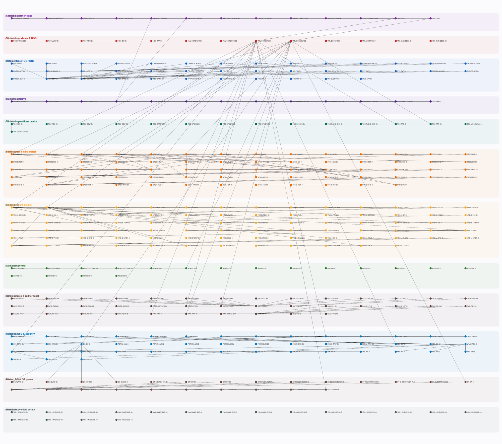

# Yokohama Automated Maritime Logistics Terminal — Y-AMLT

An enterprise-scale Cisco Packet Tracer model of an automated container
terminal, generated entirely from code.



---

## At a glance

| | **enterprise** | standard | smoke |
| --- | ---: | ---: | ---: |
| **Devices** | **386** | 303 | 206 |
| **Links** | **380** | 289 | 205 |
| Devices with a running-config | 98 | 84 | 72 |
| `<LINE>` elements in those configs | 15,345 | 12,758 | 11,049 |
| DNS A-records | 384 | 301 | 204 |
| DHCP pools (distinct names) | 75 | 54 | 33 |
| RADIUS clients | 93 | 79 | 67 |
| Addresses / subnets | 507 / 133 | — | — |
| Artefact size | 1.33 MB | 1.01 MB | 0.74 MB |
| **File** | `YOKOHAMA_AMLC.pkt` | `YOKOHAMA_AMLC_standard.pkt` | `YOKOHAMA_AMLC_smoke.pkt` |

Enterprise build SHA-256:
`bb38696540ffb41a706a4f405c0f6fe82d62724a7dba1ba714b253ed40f14bb4`

---

## The 386 devices, by tier

| Tier | Devices | What it is |
| --- | ---: | --- |
| Carrier & partner edge | 11 | transit clouds, eBGP edge, customs gateway, vessel-traffic service, rail operator, shipping-line EDI, partner DMZ |
| Terminal backbone & NOC | 8 | dual collapsed core, core routers, dual WAN edge, data-centre interconnect, management gateway, NOC enclave |
| Data centres (TDC / DR) | 30 | spine/leaf, a 24-service server farm, and a hot-standby DR site |
| Customs enclave | 15 | dual firewalls, manifest database pair, customs brokers, HSM, WORM audit log, IDS, capture tap |
| Terminal operations centre | 15 | dual zone routers, distribution and access switching, video wall, dispatch consoles, radio dispatch |
| Berth apron & STS cranes | 68 | 4 berths, each with dual L3 industrial switches; **12 ship-to-shore cranes**, each with an industrial switch, motion PLC, operator HMI, spreader RFID and travel sensor |
| Container yard blocks | 82 | **16 RTG yard blocks**, each with an industrial switch, crane controller, yard RFID portal, reefer temperature monitor and safety alarm |
| AGV fleet control | 18 | dual zone routers, control-room switches, redundant fleet dispatchers, 12 onboard vehicle controllers |
| Gate complex & rail terminal | 38 | 6 OCR gate lanes (RFID, barrier PLC, camera each), rail RMG cranes and signalling interlock |
| Wireless, CFS & security | 49 | dual WLAN controllers, 14 outdoor APs, warehouse, CCTV, access control, perimeter intrusion |
| Reefer, dangerous goods & OT power | 25 | reefer bank monitors, hazmat detection, substation and shore-power PLCs, energy controller, power meters |
| Mobile estate | 18 | handheld and vehicle-mount terminals |
| | **386** | |

Modelled from 37 distinct device types, including industrial switching
(`IE-9320`, `IE-3400`, `IE-2000`), industrial routing (`IR1101`, `CGR1240`,
`ISA-3000`) and IoT/OT endpoints (PLC, HMI, RFID, motion, temperature, smoke,
water-level, trip, power-meter).

---

## What it models

A container terminal moves boxes between three interfaces — ship, road and rail
— through a yard. Automation replaces the human drivers and crane operators with
machines under central control, which changes what the network has to do:

* **Safety-critical control loops.** A dropped AGV guidance packet is a stopped
  vehicle. AGV and crane control traffic is marked at the edge and serviced
  ahead of bulk container data and CCTV (`priority 2048`, DSCP CS5).
* **Hard real-time OT beside IT.** Crane PLCs and gate barriers are industrial
  Ethernet devices; the terminal operating system is a modern application
  stack. They are separable zones, and a broadcast storm in the yard cannot
  reach the data centre — every industrial access port carries
  `storm-control ... action shutdown`.
* **Statutory separation.** Customs manifests and the customs link are a
  regulated enclave in their own address space (`172.20.0.0/16`) behind two
  firewalls, permitting only the declared message set.
* **No maintenance window.** Every zone has redundant first-hop gateways and
  dual uplinks; a terminal that stops moving boxes costs money by the minute.

### Independence, not just redundancy

Each berth is served by a **pair** of L3 industrial switches holding the berth
SVIs with first-hop redundancy, dual-homed to the two collapsed-core switches.
Each crane's own switch uplinks to *both*. Losing one switch, one uplink or one
core does not stop container handling.

### Scale honesty

Packet Tracer renders a device, not a container. A yard block here is one
*monitoring and control point* standing in for the block's real contents —
240 TEU ground slots and 64 reefer plugs. The model therefore represents
**3,840 ground slots and 1,024 monitored reefer plugs** with 16 industrial
switches, 16 crane controllers and 32 sensor endpoints. The ratio is stated
rather than implied: this is a control-plane model, not a per-box one.

---

## Screenshots

Rendered in Packet Tracer 9.0.1 — the full terminal, from the carrier edge at
the top through the berth apron, all 16 yard blocks, the AGV fleet, the gate and
rail tiers, security, OT power and the handheld estate:


The entire logical workspace, all 386 devices on one page:


---

## Credentials

The lab is meant to be entered, so the passwords are published next to the
hashes they are the preimages of — the generator stores **real MD5-crypt
hashes**, not invented ones:

| Use | Username | Password |
| --- | --- | --- |
| Privileged EXEC (`enable secret`) | — | `Yokohama#2026` |
| Device administrator (privilege 15) | `yml-admin` | `Yokohama#2026` |
| Operator (privilege 1) | `yml-ops` | `Ops#Terminal-2026` |
| TFTP archive account | `yml-archive` | `arch1ve-yml` |
| Terminal portal (HTTP/HTTPS) | `yml-portal` | `p0rtal-yml` |
| WLAN (WPA2-PSK) | — | `yml-wlan-2f81` |

> **First-open note.** Packet Tracer runs spanning-tree convergence after
> loading a file with this many switches, so some access ports show *amber* link
> lights for the first ~30 s. Toggling between Realtime and Simulation mode 3–4
> times clears it. **Amber is spanning-tree blocking, not a fault** — on a
> topology with redundant paths some ports are supposed to block.
> Packet Tracer also raises two informational prompts on open
> (*Update Devices?* and *Network Controller External Access*); neither is an
> error.

---

## Validation

Seven gates, each exiting non-zero on failure. Run from `generator/`:

| # | Gate | Proves |
| --- | --- | --- |
| 0 | `tools/audit_links.py` | every cabled port is brought up by the configuration that ships with it |
| 1 | `tools/finalise_lab.py` | layout, template residue, distinct counts, byte-exact round-trip |
| 2 | `validate.py` | config identity, port attestation, power, addressing, distinctness |
| 3 | `tools/check_layout.py` | label-inclusive geometry: no overlap, nothing off-page |
| 4 | `pkt_core.cli audit` | every printed count is of *distinct* things |
| 5 | `tools/pt_accept.py` | Packet Tracer actually opens it |
| 6 | `tools/pt_render_check.py` | it renders, and what it looks like |

Result on the enterprise build: **all gates pass, 0 failures, 0 warnings.**

### Two findings worth knowing

**A port name can make the entire file unopenable.** Not one dead cable — Packet
Tracer refuses the whole document. Three names that the reference corpus
"attested" (`7960 → FastEthernet0`, `Cloud-PT → GigabitEthernet0`,
`WLC-3504 → GigabitEthernet0/1`) are rejected by PT 9.0.1; the correct names are
`Switch`, `Port 0` and `GigabitEthernet1`. Each was measured, and the rejected
names are recorded so nobody re-tries them.

**A cable is not a configuration.** The first build passed every structural
check while shipping **87 cabled ports that nothing configured**, five firewalls
whose own outside port was administratively shut, and 45 links whose two ends
disagreed about whether they were a trunk or an access port. Measured before and
after on the rendered workspace: red link-indicator pixels fell **4538 → 300**,
and the 300 that remain are device artwork (the trip-sensor icon, the firewall
icon), not links.

The fix is structural: a port's role is now **derived from what is plugged into
it**, and the build fails if any link endpoint is cabled but not brought up.

See [`docs/VALIDATION.md`](docs/VALIDATION.md) for what each gate can and cannot
catch, and [`docs/EVIDENCE.md`](docs/EVIDENCE.md) for where every format and
port fact came from — including the things that were measured and turned out
*not* to be true.

---

## Files

```
YOKOHAMA_AMLC.pkt            386 devices — the deliverable
YOKOHAMA_AMLC_standard.pkt   303 devices
YOKOHAMA_AMLC_smoke.pkt      206 devices — fast iteration
generator/
  build_yokohama_amlc.py     the topology generator
  yokohama_kit.py            IOS / ASA config and Server-PT service generators
  yokohama_paths.py          locates the toolkit without a hardcoded path
  validate.py                identity, ports, power, addressing, distinctness
  run_all.sh                 the gate chain
  tools/                     auditing and export tools
docs/
  DESIGN.md                  full architecture specification
  VALIDATION.md              every gate, and its honest limits
  EVIDENCE.md                provenance of every format and port fact
  SERVICES.md                DNS zone, DHCP pools, RADIUS clients
  ADDRESS_PLAN.csv           507 addressed interfaces
  SUBNETS.csv  VLANS.csv  INVENTORY_enterprise.csv
  img/                       diagram and screenshots
```

### Reproducing the build

```console
$ git clone https://github.com/aacanadaa/packet-tracer-pkt-format.git
$ cd packet-tracer-pkt-format && python3 -m venv .venv && . .venv/bin/activate
$ pip install -e . pytest pydantic
$ export PKT_TOOLKIT="$PWD"

$ cd generator
$ ./run_all.sh enterprise
```

The build is deterministic: device placement, physical-workspace identifiers,
MAC addresses and every other identifier derive from stable inputs, so two runs
of the same profile produce **byte-identical** output and the published SHA-256
can be re-derived by anyone.

Nothing here hardcodes a developer's home directory; the toolkit is located by
`PKT_TOOLKIT` or by searching upwards, and the build fails with instructions
rather than a `ModuleNotFoundError` if it cannot be found.

---

## Licence

GPL-3.0-or-later, matching the toolkit the generator builds on. The generated
`.pkt` is your own artefact.
